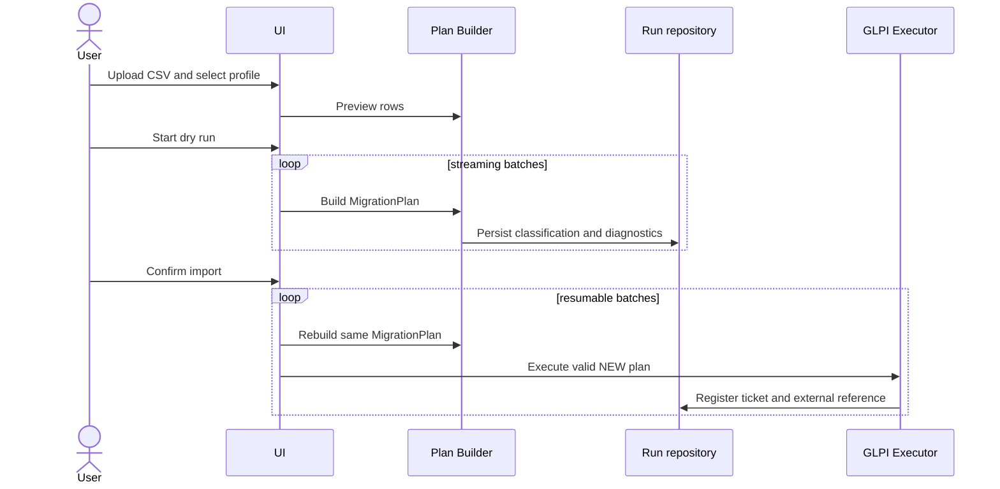

# Migration flow

Before this execution sequence, the configuration workflow is persisted and resumable: create profile → select active source revision → save positional mapping → validate resolvers/value mappings → dry run. Reopening a profile resumes at its recorded step and never requires a redundant upload. Selecting a source with a different schema fingerprint invalidates later configuration steps.

Before pilot execution, the operator can navigate the same immutable plan builder row by row and compare essential actor, location, entity, and generated-title resolutions with their CSV source values. The **Import this pilot row** action rebuilds and executes that exact plan, creates one real GLPI ticket, fills its native GLPI **External ID**, records a one-row pilot run, and registers its external reference and canonical row hash in one transaction. Reopening that source row links to the created ticket instead of offering a second creation. A shared profile-scoped database lock prevents pilot and final workers, including workers from different runs, from creating tickets concurrently. The final classifier therefore sees the same external reference as already imported and skips an unchanged pilot row; a changed row is reported as `CHANGED` and is never automatically duplicated or updated.

Before final bulk execution, the operator explicitly acknowledges responsibility for suitable backup preparation. The plugin records the GLPI user and timestamp but neither creates nor verifies a dump. The UI and server-side controller block final import when this acknowledgement is absent.

Classification precedes execution: unknown external ID is `NEW`; known ID with the same canonical hash is `SKIP`; known ID with a different hash is `CHANGED`. V1 does not update `CHANGED` tickets automatically.

The current executor creates tickets and actors and registers external references. Followups, tasks, documents, solutions, relations and historical metadata restoration are future work; they are not executed in version 0.1.2. Live integration tests against GLPI 12.0.8 remain necessary to validate its native lifecycle.

Each final row commits the GLPI ticket, its reference, trace and progress together. Registered references to missing, deleted or inaccessible tickets are reported without replacement creation. Critical persistence failures roll the row back and pause the run. Closing the browser must not lose progress. Dry run may write technical report state but creates no GLPI business object.

Final execution uses short browser-driven batches. Each row ends as imported, already imported, changed, or failed; one row failure does not stop the remaining source. A browser can resume the same frozen run. If mappings or source data must be corrected, the operator starts a new run: the external-reference ledger skips successful rows and attempts only unresolved work. A semicolon-delimited trace export exposes all per-row diagnostics without ticket content and neutralizes spreadsheet formula prefixes.
